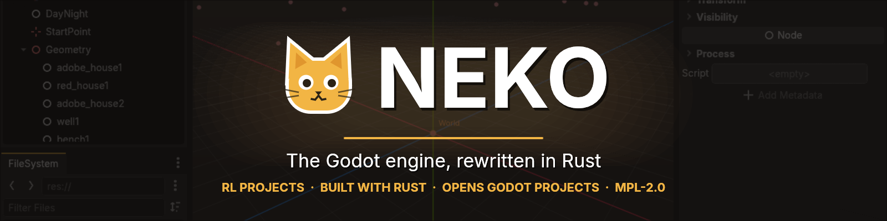
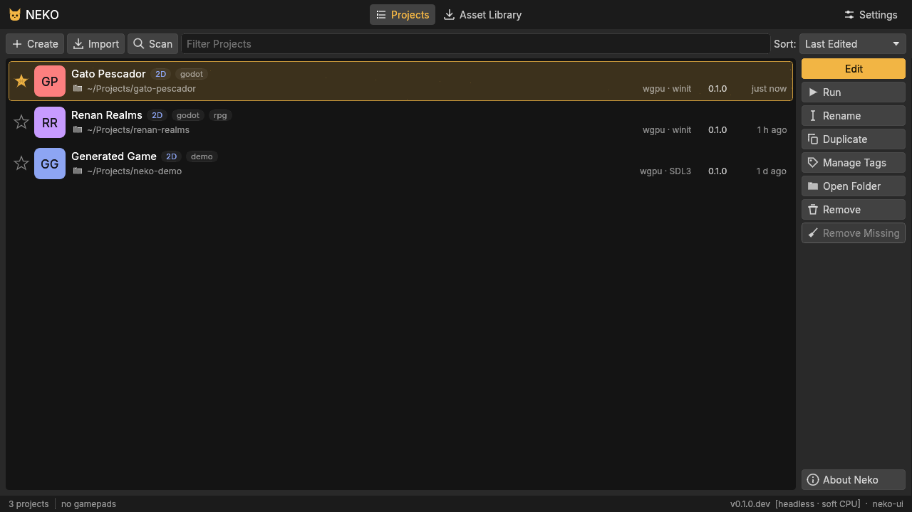
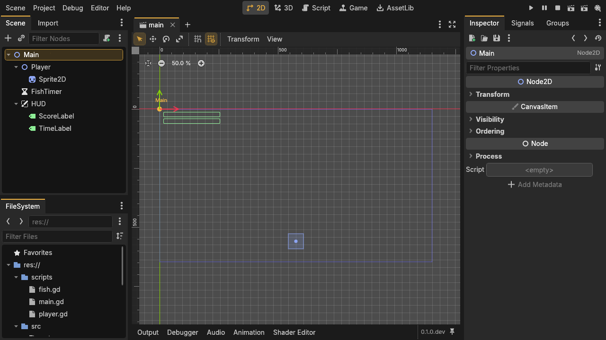
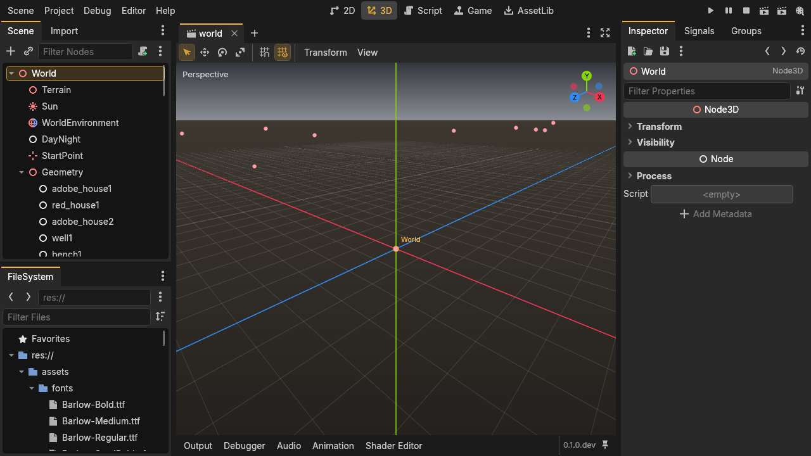
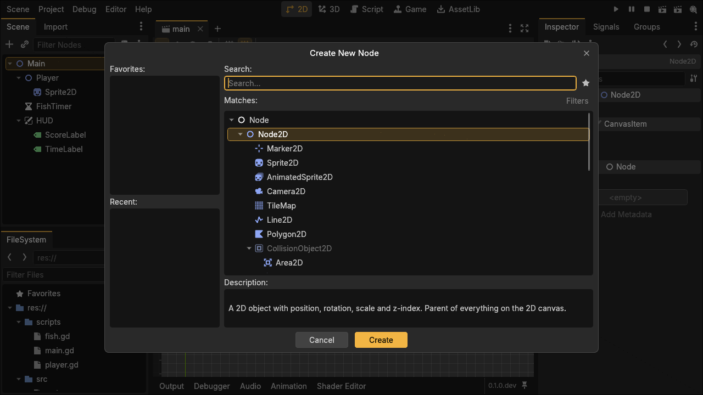
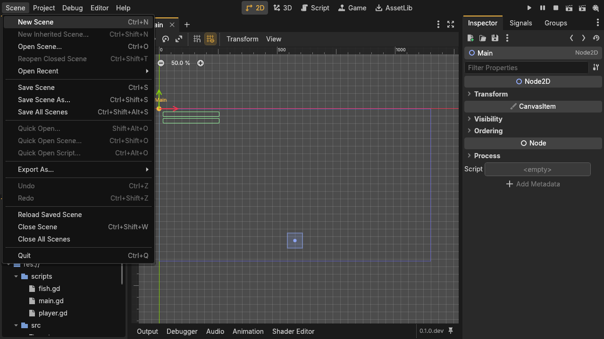
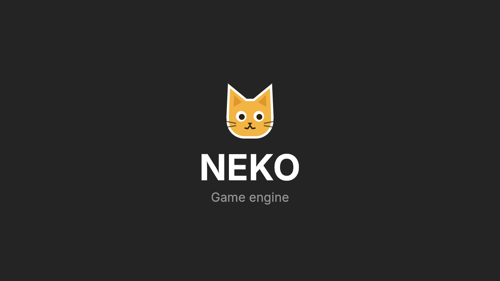
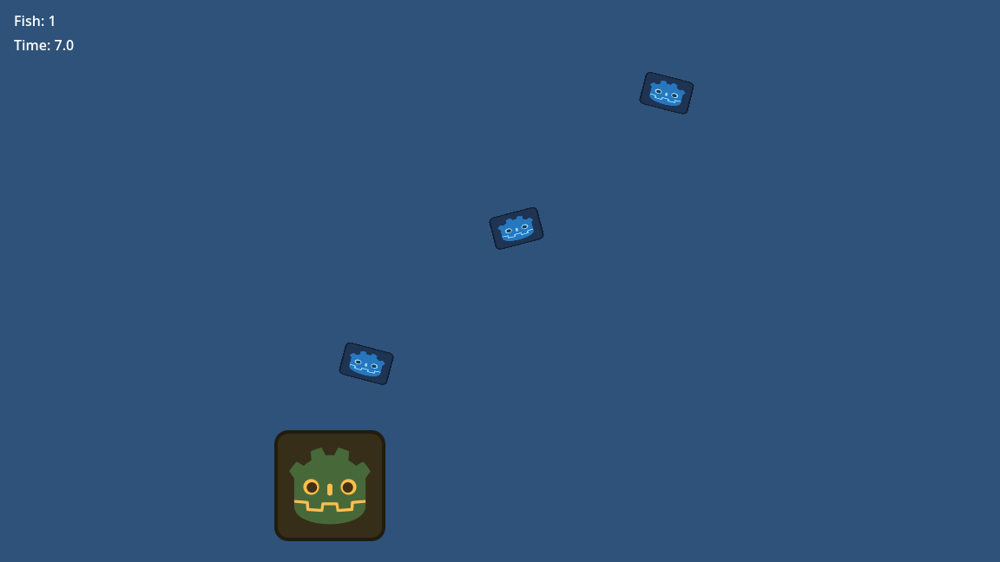
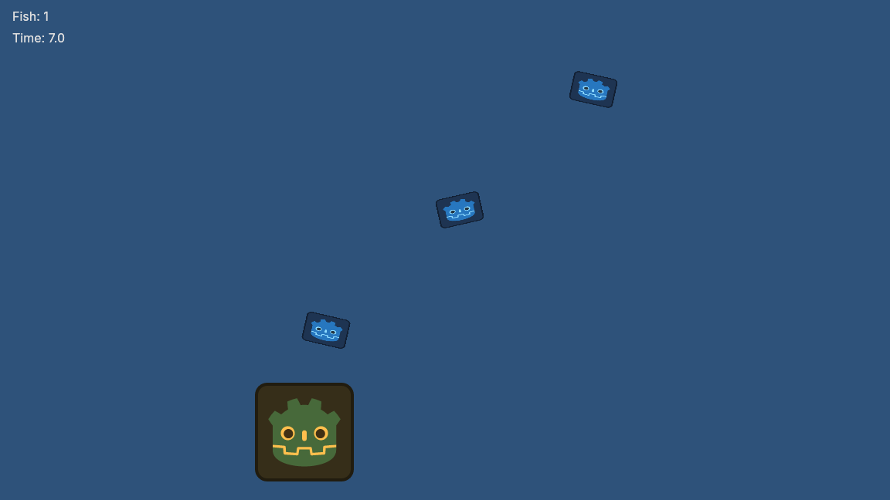
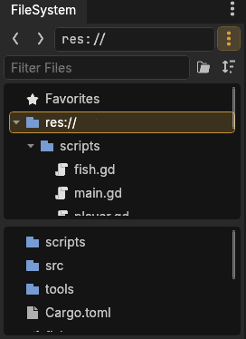

<div align="center">



<h3>The Godot engine, rewritten in Rust</h3>

<p>
  <a href="https://www.rust-lang.org/"></a>
  <a href="LICENSE"></a>
  <a href="https://godotengine.org/"></a>
  <a href="https://wgpu.rs/"></a>
</p>

<p>
  
  
  
  
  
  
  
</p>

<p>
  <a href="#getting-started"><b>Getting started</b></a> ·
  <a href="#godot-compatibility"><b>Godot compatibility</b></a> ·
  <a href="#nekoscript"><b>NekoScript</b></a> ·
  <a href="#backends-and-porting"><b>Backends</b></a> ·
  <a href="#workspace"><b>Workspace</b></a>
</p>

</div>

---

**Neko** is a reimplementation of the [Godot](https://godotengine.org/) engine
and editor in **Rust**. It looks and works like Godot — same menus, docks,
shortcuts and file formats — with Neko's amber accent. Its focus is to be
**lighter, faster and extremely portable**: every platform, renderer and audio
system is a separate backend crate, so bringing Neko to a new OS or console
means writing backends, never touching the engine.

> Neko is young. The editor, the Godot file formats, NekoScript, `await` and
> basic 2D physics work today; 3D rendering in games and much of the engine
> API are still being built. See [Status](#status).

---

## Screenshots

| Project manager | 2D editor |
|---|---|
|  |  |

| 3D editor (a Godot project) | Create New Node |
|---|---|
|  |  |

| Scene menu | Boot splash |
|---|---|
|  |  |

### The same game in Godot and in Neko

*Gato Pescador*, a small game made in Godot 4.7 (scenes saved by Godot
itself), opened unchanged in Neko. With the same input, both engines print the
same log, frame for frame.

| Godot 4.7.2 | Neko |
|---|---|
|  |  |

---

## Table of contents

- [Highlights](#highlights)
- [Getting started](#getting-started)
- [Project manager](#project-manager)
- [Editor shortcuts](#editor-shortcuts)
- [FileSystem dock](#filesystem-dock)
- [Godot compatibility](#godot-compatibility)
- [NekoScript](#nekoscript)
- [Project files](#project-files)
- [Backends and porting](#backends-and-porting)
- [Workspace](#workspace)
- [Development](#development)
- [Status](#status)
- [License](#license)

---

## Highlights

- **Godot's editor, in Rust**: menus, docks, inspector sections, rulers and
  dialogs taken from Godot 4.7's source, drawn by Neko's own GUI (`neko-ui`).
- **Project manager and FileSystem dock**: create, import, scan and launch
  projects; browse the project as a tree plus file list, with favorites,
  path history, drag-and-drop import from the OS, and
  create/rename/duplicate/delete on disk.
- **Opens Godot projects**: `.tscn` scenes and `project.godot` settings are
  read and written in Godot's own formats; anything Neko does not know yet is
  kept untouched. Renaming or moving a resource rewrites the `res://`
  references in scenes, resources and scripts, as Godot does.
- **NekoScript**: runs GDScript `.gd` files with Godot's semantics.
- **Modular by design**: window, renderer, GPU, audio and OS are traits with
  swappable backend crates selected by Cargo features.
- **Portable**: winit (Wayland, X11, Win32, Cocoa, Android, Web), SDL3, wgpu
  (Vulkan, Metal, D3D12, GL, WebGPU) and a CPU renderer that runs anywhere.
- **Light**: games compile only the backends and modules they use.

---

## Getting started

Neko needs **Rust 1.85 or newer** (the workspace uses edition 2024) and
Cargo. The default wgpu renderer uses Vulkan, Metal or D3D12; `--render soft`
draws on the CPU and needs no GPU. SDL3 is optional and loaded at runtime for
SDL3 windows and gamepads.

```sh
git clone <repository-url> neko
cd neko
cargo build --release                     # target/release/neko
cargo run --release                       # project manager + editor (winit + wgpu)
cargo test --workspace                    # unit and format round-trip tests
```

| Command | What it does |
|---|---|
| `cargo run --release -- --open <folder>` | open a project directly (Neko or Godot) |
| `cargo run --release -- --window sdl3` | use SDL3 for the window |
| `cargo run --release -- --render soft` | CPU renderer, no GPU needed |
| `cargo run --release -- --gpu gl` | force a wgpu API (`vulkan`, `gl`, `metal`, `dx12`) |
| `cargo run --release -- --screenshot out.png` | headless PNG of the UI |

In the editor, **F5** runs the main scene and **F6** the current scene: the
game is built with `cargo run` and its output appears in the Output panel.
The entry point is `[application] run/main_scene` in `project.neko`.

---

## Project manager

Neko starts in a project manager modeled on Godot's
`editor/project_manager/`: the same top bar, project list, action column and
Create New Project dialog.

| Action | What it does |
|---|---|
| **Create** (`Ctrl+N`) | new project: name, folder, template, renderer, targets, optional Git |
| **Import** (`Ctrl+I`) | folder browser; add an existing Neko or Godot project, or drop a folder on the window |
| **Scan** | folder browser; find projects three levels below and add them |
| **Filter** (`Ctrl+F`) / **Sort** | filter by name or path; sort by last edited, name or path |
| **Edit** (`Enter`) | open the selected project in the editor |
| **Run** | `cargo run` in the project folder |
| **Rename**, **Duplicate**, **Manage Tags** | edit the project name, copy the folder, or tag the list entry |
| **Open Folder**, **Remove** (`Delete`) | open the project folder; remove it from the list (files stay) |
| **Remove Missing** | drop entries whose folder no longer exists |

**Import** and **Scan** open a folder browser (path bar, folder tree and a
status line that recognizes Neko and Godot projects), so importing a project
does not mean typing a path from memory. The status bar shows the project
count, connected gamepads (read through SDL3, like Godot) and the
window/renderer in use. New projects get a small Cargo crate that runs the
game; see [Project files](#project-files).

---

## Editor shortcuts

| Keys | Action |
|---|---|
| Ctrl+N / Ctrl+O | New scene / open scene |
| Ctrl+S / Ctrl+Shift+S | Save scene / save as |
| Ctrl+Shift+W | Close scene tab |
| Ctrl+Z / Ctrl+Shift+Z | Undo / redo |
| Ctrl+A | Add child node |
| Ctrl+D / Del / F2 | Duplicate / delete / rename node |
| Q W E S | Select, move, rotate, scale tool |
| F5 / F6 / F8 | Run main scene / run current scene / stop |
| Shift+F11 | Fullscreen |
| Right drag, wheel | Pan or orbit, zoom |

### FileSystem dock

| Keys | Action |
|---|---|
| Ctrl+L | Focus the path bar |
| Enter | Open the selected scene, or enter the selected folder |
| F2 | Rename the selected file or folder |
| Delete | Delete the selected file or folder (asks first) |
| Ctrl+D | Duplicate the selected file or folder |
| Ctrl+Shift+C / Ctrl+Alt+C | Copy the `res://` path / absolute path |
| Ctrl+Alt+R | Open the selection in the OS file manager |

The same keys go to the dock only while its tree or file list has focus, so
**Ctrl+D** duplicates a node in the Scene dock and a file in the FileSystem
dock.

---

## FileSystem dock



The FileSystem dock follows Godot's `editor/docks/filesystem_dock.cpp`:

- **Favorites** at the top, then the project tree (`res://`), and below it
  the contents of the current folder. The last button on the path row toggles
  this split view; the sort button switches between name and file type.
- **History**: Back and Forward walk through the folders you visited. The
  path bar accepts `res://scenes`, an absolute folder, or `Favorites`;
  **Enter** navigates.
- **Double-click** opens scenes in a tab and enters folders. Other resources
  (scripts, images, audio) open in the OS default program, and **Open in File
  Manager** shows the folder.
- **Create New** from the context menu creates a folder, a scene (choosing its
  root type), a script (choosing its base class) or an empty text file.
- **Import**: drop files or folders from the OS into the dock and they are
  copied into the folder under the mouse, like Godot's `files_dropped`. The
  **Import** button (next to the file filter) opens a small file browser for
  the same copy; `.uid` and `.import` sidecars come along.
- **Rename** happens in place; **Duplicate** suggests an unused
  `name_copy` path; **Delete** asks for confirmation.
- **Drag** a file or folder onto a folder to move it, hold **Ctrl** to copy,
  or drop it on **Favorites** to pin it. `.uid` and `.import` sidecars follow
  their resource.
- Every move, rename or deletion updates open scene tabs, favorites, recent
  scenes and `run/main_scene`, and rewrites `res://` references in `.tscn`,
  `.tres`, `.gd` and `.gdextension` files.

File operations are real filesystem operations: Neko writes `project.neko`
and the resources directly, and never silently converts a file it does not
understand. Still missing from the dock: multi-selection, the
Move/Duplicate To dialog, folder colors, resource creation, and dependency
viewers.

---

## Script editor

Double-click a `.gd` file in the FileSystem dock (or use **File > Open** in
the Script workspace) to edit it in Godot's ScriptEditor layout: scripts and
methods on the left, a `CodeEdit` with a line gutter, syntax colors, current
line highlight and a find bar, then the error/line-and-column status bar.

**Code completion** follows Godot's `CodeEdit` and GDScript completion:

- **Members after `.`**: script members, inherited class properties and
  engine methods. Types come from declarations (`var sprite: Sprite2D`),
  inferred constructors (`:= Vector2(...)`), function parameters and locals,
  and are followed through chains (`self.sprite.position.x`).
- **Symbols**: local variables, parameters, `for` variables, functions,
  constants, signals, enums (and their values after `Enum.`), built-in types,
  global functions, annotations after `@`, and every class in the ClassDB.
- **Scenes and files**: `$Node/Paths` from the open scene, `%UniqueName`
  references, and `res://` paths inside `preload(...)`, `load(...)` and
  `extends "..."`.
- Fuzzy matching (e.g. typing `sfp` finds `set_physics_process`) with the
  typed characters highlighted, icons per kind, seven visible rows and a
  scroll bar.

| Keys | Action |
|---|---|
| Ctrl+Space | Complete Symbol (also in the Edit menu) |
| Up / Down, PageUp / PageDown | Move through the completion list |
| Enter / Tab | Accept the selected completion |
| Esc | Close the completion list |
| Ctrl+F / F3 / Shift+F3 | Find / next / previous |
| Ctrl+G | Go to line |
| Ctrl+K / Ctrl+Shift+K | Toggle comment / delete line |
| Ctrl+Shift+D / Alt+Up / Alt+Down | Duplicate selection / move lines |
| Ctrl+S / Ctrl+Alt+S / Shift+Alt+S | Save script / save / save all |

---

## Godot compatibility

| Godot | Neko |
|---|---|
| `.tscn` scenes (format 3, `uid://`, `unique_id`) | same files; unchanged scenes save byte for byte |
| `project.godot` | read directly; Neko writes `project.neko` in the same syntax, settings under `[neko]` |
| `[connection]` signals, `ext_resource`, `sub_resource` | supported, unknown ones preserved |
| `.gd` scripts | run by NekoScript |
| Renaming/moving resources | `res://` references rewritten in scenes, resources and scripts |
| Dropping files from the OS | copied into the project and rescanned, like Godot |
| Editor layout, menus, theme | copied from Godot 4.7's source |

Opening a folder with `project.godot` creates `project.neko` and the small
Cargo crate that runs the game; `project.godot` itself is never modified, so
the project still opens in Godot. Check files without changing them:

```sh
cargo run -p neko-core   --example tscn_check -- <folder>   # scenes
cargo run -p neko-script --example gd_check   -- <folder>   # scripts
```

---

## NekoScript

NekoScript is GDScript. The tokenizer and parser follow Godot's
`modules/gdscript`, and the interpreter follows its semantics: typed
variables, integer division, `%` formatting, signals, lambdas capturing by
value, `match` patterns with `when`, `set`/`get`, inner classes, `class_name`,
autoloads, `@onready`, `$`/`%` node paths, `preload` + `instantiate`, timers
and input actions. Scripts run in Godot's order: `_init` → `@onready` →
`_ready` (children first) → `_process` / `_physics_process` → `_input`.

`await` suspends and resumes on signals, `SceneTree` timers, tween `finished`
and other coroutine calls. Statement-level awaits (and `var x = await …`,
`if await …`, `while await …`, `return await …`) compile to a small coroutine
state machine; nested awaits inside a larger expression are not supported yet.

2D physics follows Godot's `CharacterBody2D.move_and_slide()` behavior for
axis-aligned bodies: collision layers/masks, one-way platforms, floor/wall/
ceiling detection, floor snapping and `Area2D.body_entered`/`body_exited`.
`RayCast2D` reports the first body hit. Slopes, rotation and the full
`modules/godot_physics_2d` solver are not there yet.

---

## Project files

A project is a normal folder. Opening a Godot project adds Neko's files next
to it and leaves `project.godot` unchanged, so Godot can still open the same
folder:

```text
my-game/
├── project.neko          Settings read by Neko and the generated game
├── project.godot         Kept from the Godot project (if imported)
├── Cargo.toml            Small game crate generated by Neko
├── src/main.rs           neko::run(include_str!("../project.neko"))
├── scenes/main.tscn      Godot scene files, edited in place
├── scripts/player.gd     GDScript, run by NekoScript
└── .neko/editor.toml     Editor prefs (favorites, recents); git-ignored
```

`project.neko` uses Godot's `ConfigFile` syntax. Godot settings keep their
original sections and unknown keys are preserved; Neko's own settings live
under `[neko]`:

```text
[application]

config/name="Gato Pescador"
run/main_scene="res://main.tscn"

[neko]

template="2d"
engine="0.1.0"
backends/window="winit"
backends/render="wgpu"
backends/audio="none"
```

Backends are also Cargo features: changing the game's `Cargo.toml` features
and the matching values in `project.neko` is all a build needs.

---

## Backends and porting

The engine talks to the platform only through four contracts, like Godot's
`platform/` and `drivers/` folders:

| Contract | Godot equivalent | Crate |
|---|---|---|
| `Os`, `FileSystem` | `OS`, `FileAccess`, `DirAccess` | `neko-os` |
| `Platform`, `Window` | `DisplayServer` | `neko-platform` |
| `GpuBackend` | `RenderingDeviceDriver` | `neko-gpu` |
| `AudioBackend` | `AudioDriver` | `neko-audio` |

| Layer | Implemented | Planned |
|---|---|---|
| Window & input | winit (default), SDL3 | SDL3 on macOS/iOS, headless |
| Gamepads | SDL3, rumble | sensors, touchpad |
| Renderer | wgpu, software | SDL3 GPU, OpenGL |
| Audio | dummy | SDL3, cpal |

Console ports live in their own crates and can keep the license their SDK
requires. See [docs/PORTING.md](docs/PORTING.md).

---

## Workspace

| Crate | Role |
|---|---|
| `neko` | the engine crate games depend on; backends are features |
| `neko-editor` | the `neko` binary: project manager and editor |
| `neko-core` | class database, scene tree, Godot text formats (`.tscn`, ConfigFile) |
| `neko-script` | NekoScript: GDScript tokenizer, parser and interpreter |
| `neko-ui` | Neko's own GUI, modeled on Godot's Control nodes and theme |
| `neko-project` | `project.neko`, project list, scaffolding, Godot import |
| `neko-os` | OS contract and the `StdOs` backend |
| `neko-platform` | display contract and normalized input |
| `neko-gpu` | GPU contract (Godot's `RenderingDeviceDriver`, slimmed down) |
| `neko-audio` | audio contract and `DummyAudio` |
| `neko-render` | `Renderer` trait and `Frame` |
| `neko-wgpu` | wgpu renderer with a canvas pipeline modeled on Godot's |
| `neko-soft` | CPU renderer (window or offscreen) |
| `neko-winit` | default window backend |
| `neko-sdl3`, `neko-sdl3-sys`, `neko-gamepad-sdl3` | SDL3 windows and gamepads, loaded at runtime |

---

## Development

```sh
cargo test --workspace                    # all unit and format round-trip tests
cargo fmt                                 # rustfmt

# Read a project without opening the editor or changing anything:
cargo run -p neko-core   --example tscn_check -- <folder>
cargo run -p neko-script --example gd_check   -- <folder>

# Render a UI screenshot with the CPU renderer (no window needed):
cargo run -p neko-editor -- --open <folder> --screenshot out.png --size 1280x800
NEKO_CLICKS="x,y;rx,y" cargo run -p neko-editor -- --open <folder> --screenshot out.png
```

`NEKO_CLICKS` replays clicks before the screenshot: `x,y` is a left click and
`rx,y` a right click, separated by `;`. The FileSystem dock screenshot above
was produced this way. The porting guide for new platforms is in
[docs/PORTING.md](docs/PORTING.md).

---

## Status

| Area | State |
|---|---|
| Editor (2D/3D views, inspector, menus, dialogs) | usable |
| Project manager (create, import, scan, launch) | usable |
| FileSystem dock (tree + list, favorites, file operations) | usable |
| Script editor (CodeEdit, completion, find, methods) | usable |
| Godot scenes and project files | read and write, round-trip |
| NekoScript language | complete enough for real scripts |
| Engine API for scripts | growing (2D nodes, UI, input, timers, scenes) |
| `await` | signals, timers, tweens and coroutine calls suspend and resume |
| 2D physics / collisions | CharacterBody2D, one-way platforms, Area2D overlaps, RayCast2D |
| 3D rendering in games | not yet |
| Audio | not yet |

---

## License

Neko is licensed under the [Mozilla Public License 2.0](LICENSE): changes to
Neko's own files stay open source, while games and separate crates (including
private console backends) can use any license. Code and icons ported from
Godot remain under Godot's MIT license; see
[THIRD_PARTY_NOTICES.md](THIRD_PARTY_NOTICES.md).

<div align="center"><sub>RL PROJECTS · built with Rust</sub></div>
